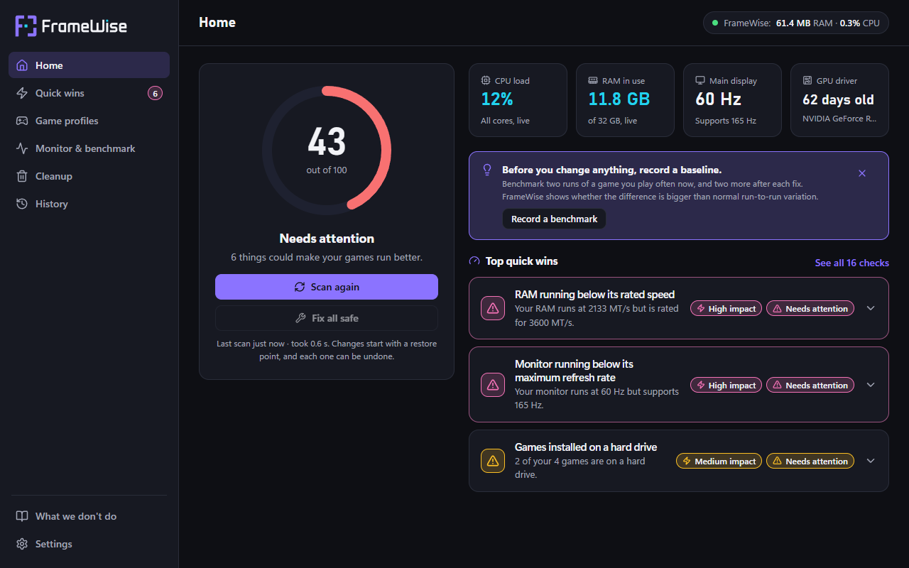
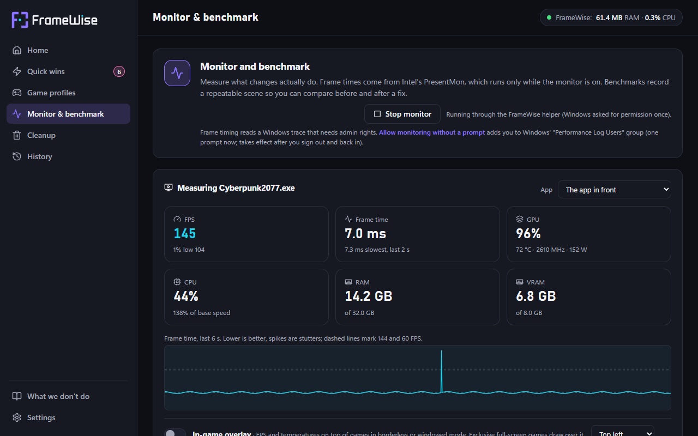
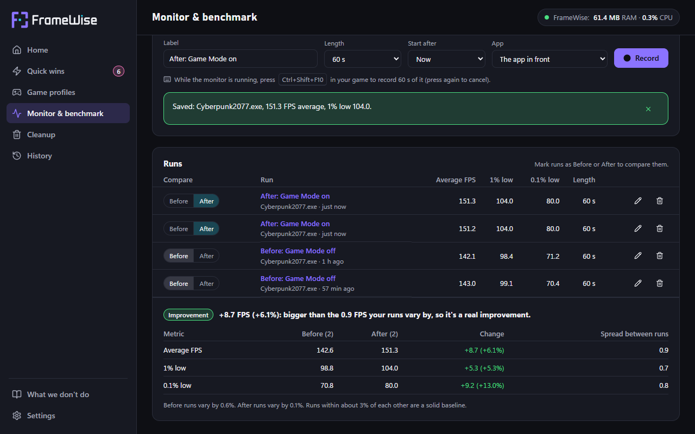
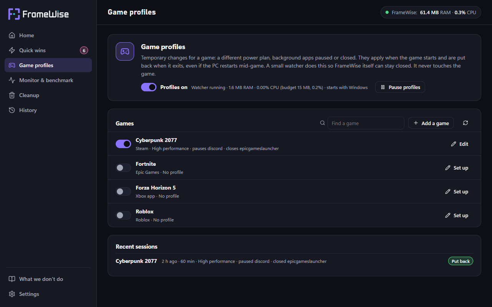
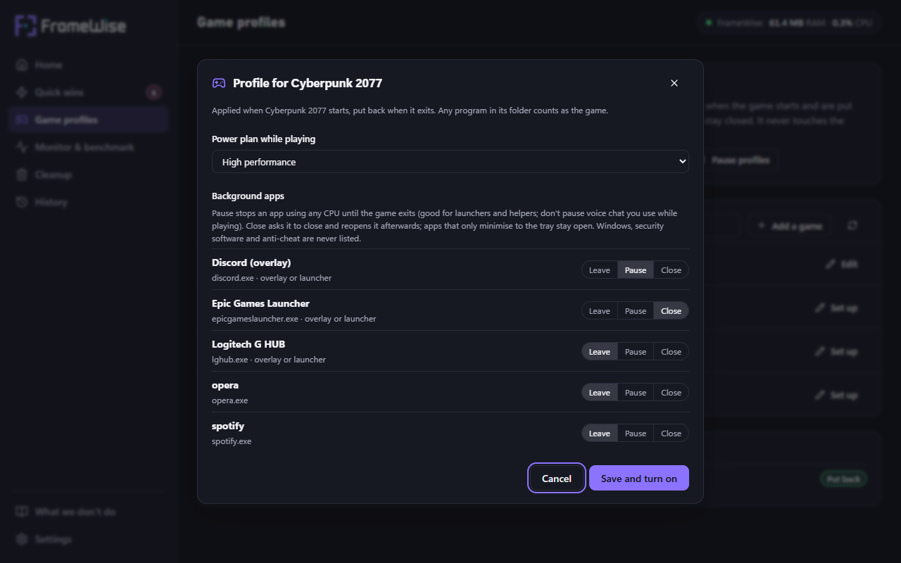
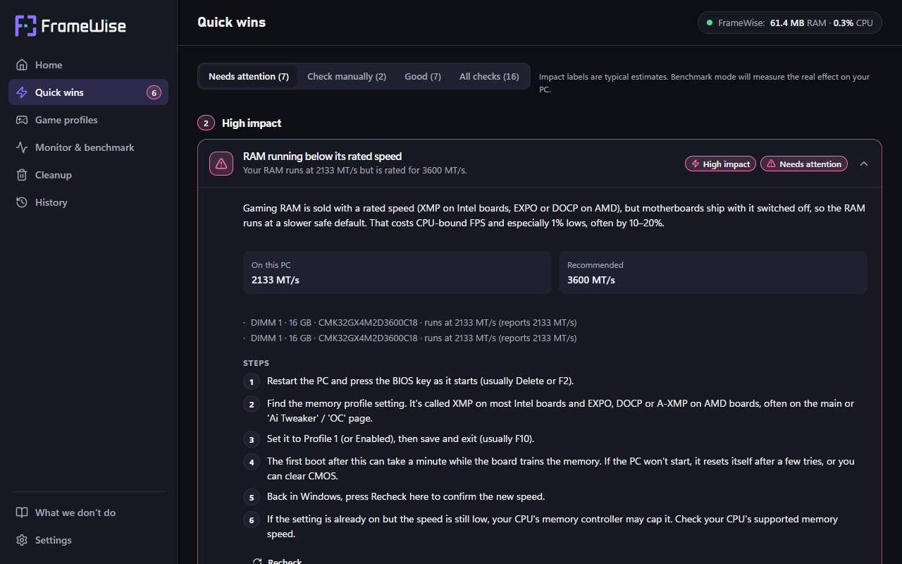
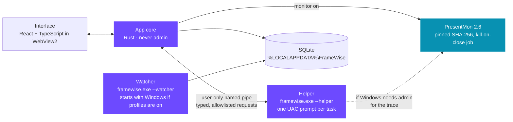

<p align="center">
  <picture>
    <source media="(prefers-color-scheme: dark)" srcset="logo/kit/masters/framewise-horizontal-on-dark.svg">
    
  </picture>
</p>

<p align="center">
  <b>The honest Windows gaming optimiser.</b><br>
  Finds what really costs you frames, fixes it reversibly, and proves the gain with benchmarks.
</p>

<p align="center">
  
  
  
  
  <a href="LICENSE"></a>
</p>

<p align="center">
  
</p>

Most PC optimisers sell satisfying numbers ("Freed 3.2 GB!", "Fixed 847 issues!") from RAM and
registry cleaners that do nothing or make things worse. The real wins go unnoticed: RAM running
below its rated speed, a 165 Hz monitor stuck at 60 Hz, games on a hard drive. FrameWise finds
those, explains them in plain language, fixes them so every change can be undone, and measures
what each fix actually did.

## Why FrameWise

| Principle | What it means |
| --- | --- |
| **Evidence over claims** | Every fix states its expected impact, and benchmark mode measures the real one. A gain only counts if it beats the normal variation between runs. |
| **Everything reversible** | Each change is checked, applied, verified and logged with its old value, with a Windows restore point first. Every change has its own Undo. |
| **No snake oil** | No RAM cleaning, registry cleaning or service stripping. The app explains why on its "What we don't do" page. |
| **Near-zero footprint** | FrameWise shows its own RAM and CPU at all times. The background watcher uses about 2 MB and closes nothing it didn't open. |
| **Never admin by default** | The app never runs as administrator. A tiny helper does machine-wide work after one UAC prompt, and only from a fixed allowlist. |

## Features

| | Feature | What it does |
| :-: | --- | --- |
| 1 | **Scan and health score** | 16 read-only checks in under a second: RAM speed and channels, refresh rate, GPU driver age, games on HDDs, power plan, Game Mode, GPU scheduling, Memory Integrity, startup apps, overlays, throttling, drive space, ping and more. |
| 2 | **Quick wins and fixes** | Plain-language explanations, step-by-step guides, one-click fixes and **Fix all safe**, each with Undo. |
| 2 | **Cleanup** | Temp files, crash dumps, old Windows Update downloads and old GPU driver packages, measured first. Your files go to the Recycle Bin. |
| 2 | **History** | Every change and cleanup, the restore points made, and a plain-text report. |
| 3 | **Live monitor** | FPS, 1% low, frame time, GPU and CPU load, temperatures, clocks, RAM and VRAM, with throttling warnings. |
| 3 | **In-game overlay** | A small click-through panel over borderless and windowed games. Never injected into a game. |
| 3 | **Benchmarks** | Record 30 s to 2 min of a repeatable scene (or press **Ctrl+Shift+F10** in game), then compare runs before and after a change. |
| – | **Standby-list clearing** | An advanced, one-off option on the "What we don't do" page for 8–16 GB PCs, worth keeping only if a before/after benchmark shows a gain. |
| – | **Crash reports** | Saved on the PC with paths and user names removed. You see the exact text and choose whether to open it as a GitHub issue. |
| 4 | **Game profiles** | When a game starts: switch the power plan, pause or close background apps. Everything is put back when it exits, even after a crash or restart. |

<table>
  <tr>
    <td width="50%"></td>
    <td width="50%"></td>
  </tr>
  <tr>
    <td align="center"><sub><b>Live monitor:</b> frame times from Intel PresentMon, sensors from Windows and NVML</sub></td>
    <td align="center"><sub><b>Before and after:</b> a gain only counts when it beats the spread between runs</sub></td>
  </tr>
  <tr>
    <td width="50%"></td>
    <td width="50%"></td>
  </tr>
  <tr>
    <td align="center"><sub><b>Game profiles:</b> games found in Steam, Epic, Battle.net, the Xbox app and Roblox</sub></td>
    <td align="center"><sub><b>Profile editor:</b> leave, pause or close each background app</sub></td>
  </tr>
  <tr>
    <td colspan="2"></td>
  </tr>
  <tr>
    <td colspan="2" align="center"><sub><b>Quick wins:</b> what's on this PC, what it should be, and how to fix it</sub></td>
  </tr>
</table>

<sub>Screenshots use the interface's built-in sample data, not a real PC.</sub>

## Install

Each release on the [Releases page](https://github.com/danieladekunle123/FrameWise/releases) has
three downloads:

| Download | Choose it if |
| --- | --- |
| **FrameWise_x.y.z_x64-setup.exe** | You want the normal install (recommended). |
| FrameWise_x.y.z_x64_en-US.msi | You or your IT tools prefer MSI packages. |
| FrameWise_x.y.z_x64_portable.zip | You don't want anything installed. No game profiles, no automatic updates. |

The installers put FrameWise in Program Files for all users, because its admin helper must live where
only administrators can change it. FrameWise checks for updates when it starts (you can turn this off
in Settings), verifies each update's signature, and only installs when you click **Install and
restart**. Uninstalling stops the game-profile watcher and removes its startup entry.

> [!IMPORTANT]
> Releases aren't code-signed yet, so Windows SmartScreen warns about the installer, and the
> permission prompt for machine-wide fixes shows "Publisher: Unknown". See [RELEASING.md](RELEASING.md).

## Getting started (building from source)

**You need:** Windows 10 or 11 with WebView2 (built into Windows 11), Rust (stable, MSVC toolchain)
with Visual Studio Build Tools (C++ workload), and Node.js 20 or later.

```bash
npm install
npm run app:dev          # run the app with hot reload
npm run app:build        # build the MSI and NSIS installers
npx tauri build --no-bundle   # just the release exe (with PresentMon next to it)
```

```bash
npm run dev              # the interface alone in a browser, with sample data
npm test                 # interface tests and the WCAG contrast check (Vitest)
npm run e2e              # end-to-end tests against the built app (Playwright)
powershell -ExecutionPolicy Bypass -File scripts\admin-e2e.ps1   # the same as admin (one UAC prompt)
cargo test --workspace   # checks, scoring, fixes, frame statistics, profiles and storage
```

Scan a PC from the command line, without the app:

```bash
cargo run -p framewise-checks --example scan
cargo run -p framewise-checks --example games     # games found for profiles
```

> [!NOTE]
> Release builds must go through `npx tauri build`. A plain `cargo build --release` doesn't embed
> the interface. Installers, signing keys and the release workflow are described in
> [RELEASING.md](RELEASING.md); every push runs the tests and the watcher's footprint check in GitHub
> Actions (`.github/workflows/ci.yml`).

## How it works



- **Every change goes through one pipeline:** check the current value, make a restore point before
  the first change of the session, apply, re-read to verify (rolled back if it didn't stick), then
  log the old and new value.
- **The helper** is the same `framewise.exe` started with `--helper`. It talks to the core over a
  pipe with a random name, created first-instance-only and local-only, with an access list for the
  current user only. It accepts only typed requests (`HelperRequest` in
  `crates/framewise-checks/src/tweak.rs`), each checked against an allowlist; Cleanup requests name a
  category, never a path. It exits when the task ends.
- **Per-user settings are changed by the core directly.** An elevated process could write them to
  an administrator's account instead of yours.
- **The watcher** sleeps until Windows reports a new foreground window, and never polls. When a
  profiled game appears, it saves the current state, applies the profile and waits on the game's
  processes; when the last one exits, it puts everything back. It never touches the game itself,
  needs no admin rights and never changes security settings.
- **Frame timing** uses Intel's PresentMon, bundled and run only while the monitor is on. Windows
  needs admin rights or the "Performance Log Users" group for its graphics trace. Without them the
  helper runs PresentMon after one prompt, and a button adds you to the group so later sessions
  need none.

## Footprint

FrameWise measures itself the way Task Manager's "Memory" column does (private working set), and
shows it in the header at all times.

| Process | When it runs | Budget | Measured (RTX 4060 Ti, Windows 11) |
| --- | --- | --- | --- |
| Interface (window + WebView2) | While the app is open | 100 MB, under 2% CPU idle | 85–92 MB, about 0% CPU |
| Watcher | Always, only if profiles are on | 15 MB, under 0.2% CPU | **2.0 MB peak, 0.011% CPU** over 10 min |
| Monitor (PresentMon) | Only while you monitor or benchmark | 40 MB, under 1.5% CPU | 5.8 MB, 0.05% CPU |
| Helper | Only while applying a fix | 30 MB, short bursts | Exits when done |

```bash
powershell -File scripts/measure-footprint.ps1 -Runs 3     # the interface, release build
```

## Tested

Each phase of the design document has a gate. All four were run on the development PC on
2026-11-07 and 2026-11-08.

| Phase | Gate | Result |
| --- | --- | --- |
| 1 · Scanner | Scan under 30 s; interface under 80 MB (raised to 100 MB on 2026-11-07 after measuring WebView2) | **Passed:** scan under 1 s, interface 85–92 MB |
| 2 · Safe fixes | Every fix passes apply, verify, undo, verify on Windows 10 and 11 | **Passed**, except the refresh-rate round trip, which needs a PC with an ordinary monitor |
| 3 · Monitor and benchmark | Benchmark results repeat within normal variation | **Passed:** three runs within 1.8%; a 20% heavier load detected as −19.5% |
| 4 · Game profiles | Watcher within 15 MB and 0.2% CPU over 10 minutes of game launches | **Passed:** 2.0 MB peak, 0.011% CPU, applied and restored 10/10 |

**Automated on every push** (`.github/workflows/ci.yml`): the type check, 60 interface tests including a
WCAG AA contrast check of both themes' colours, 58 Rust tests, end-to-end tests that drive the built app
with Playwright (first run and scan; a safe fix applied, shown in History and undone; the standby list
cleared), and the watcher's footprint against its budget. The end-to-end tests use a throwaway data folder
(`FRAMEWISE_DATA_DIR`, `WEBVIEW2_USER_DATA_FOLDER`), so they never touch your own data.

The benchmark end-to-end test needs frame capture, so it needs admin rights and a real GPU. CI runners
have no GPU, so it runs on a gaming PC through `scripts/admin-e2e.ps1`. All four end-to-end tests
passed that way on Windows 11 with an RTX 4060 Ti on 2026-11-09 (the standby list went from 9.3 GB to 0 MB).

<details>
<summary><b>Phase 2: fixes, Cleanup and the helper</b></summary>

- **Per-user fixes** (Game Mode, windowed optimisations, power plan, power mode, a startup entry):
  `examples/roundtrip.rs` passed on Windows 11 (build 26300) and Windows 10 22H2 (build 19045), with
  each setting back exactly as it was.
- **Machine-wide fixes** (GPU scheduling, Memory Integrity, an all-users startup entry): passed
  elevated on both. In a Windows 10 VM, `examples/restart_check.rs` switched GPU scheduling and Memory
  Integrity on, restarted, confirmed both survived, and put them back. The VM can't run either feature,
  and FrameWise said so ("not supported", "switched on, not running yet").
- **Restore points:** both a new point and Windows' 24-hour reuse were seen and reported correctly.
  System Restore switched off is reported as off.
- **The real app, elevated:** an all-users startup entry was disabled through one UAC prompt, then
  undone byte for byte through a second.
- **Cleanup:** Windows Temp (264 MB), crash dumps (59 MB) and old update downloads were removed, and
  every recently changed file survived. Driver package removal is covered by unit tests only, because
  the development PC has just the driver in use.
- **Helper channel:** `framewise.exe --selftest-helper` (debug builds) checks the pipe, the process
  checks, and that the helper refuses per-user settings, invalid values, path tricks and unknown
  requests.
- **Refresh rate:** `roundtrip -- --display` couldn't complete. The development PC's display reports
  no monitor information, so Windows only lists 60 Hz, which the driver refuses. FrameWise refused
  safely and left 240 Hz in place. `examples/modes.rs` prints both mode lists.
- `scripts/phase2-admin-tests.ps1` runs every admin check after one UAC prompt, and
  `scripts/vm-tests.ps1` runs them inside a test VM. Each writes a `*-results*.txt` file next to it
  (not committed: it lists the PC's own restore points).

</details>

<details>
<summary><b>Phase 3: monitor and benchmarks</b></summary>

Tests used `examples/test_scene.rs`, an uncapped Direct3D 11 scene with fixed work per frame, with
Discord and Opera open.

- **Repeatability:** three 30 s runs measured 134.6, 133.9 and 132.2 FPS (1.8%). Two at a 20% heavier
  load measured 106.3 and 108.8 FPS (2.3%).
- **Comparison:** base against heavier came out −19.5%, and "worse" on average FPS, 1% and 0.1% lows.
- **Accuracy:** PresentMon counted 3,411 of the scene's 3,414 frames (109.6 vs 109.8 FPS). Runs whose
  frames cover less than 95% of the time they span are rejected, not saved.
- **Overhead:** the scene ran at 119.4–119.8 FPS with the monitor off and 119.1–119.8 with it on.
- **Definitions:** frame time comes from PresentMon 2's `MsBetweenAppStart`. The 1% and 0.1% lows are
  the average of the slowest 1% and 0.1% of frames, as GamersNexus and CapFrameX report them.
- **A busy PC changes results:** with another game running in the background, the same scene swung by
  up to 20%. Benchmark the same scene with nothing else running.
- `framewise.exe --capture-test <seconds>` (debug builds) starts capture the way the monitor does
  and reports frames per app.

</details>

<details>
<summary><b>Phase 4: game profiles</b></summary>

Tests used copies of the test scene as a "game" (`game_sim.exe`) and two background apps.

- **Budget:** 10 game launches in 10 minutes. The profile was applied and put back all 10 times. The
  watcher peaked at 2.0 MB and averaged 0.011% CPU, measured every 2 s by
  `examples/footprint_watch.rs`.
- **Apply and restore:**
  - The power plan switched from High performance to Balanced, and back afterwards.
  - One app was suspended (every thread), then resumed.
  - Another closed, then reopened with exactly its original command line.
- **Crash recovery:** the watcher was killed mid-game and the game closed with no watcher running. The
  next watcher start restored everything.
- **Turning profiles off** put everything back, stopped the watcher and removed its startup entry.
- **Not yet tested:** a real game with anti-cheat, and the tray menu clicked by hand.

</details>

## Data and privacy

Everything stays on the PC, in `%LOCALAPPDATA%\FrameWise\framewise.db` (SQLite) plus benchmark
frame-time files next to it. There's no account and no telemetry. The network is used for two
things: the ping check, which times a TCP handshake to 1.1.1.1 (or 8.8.8.8) and sends no data, and the
update check, which downloads `latest.json` from this repository's releases when FrameWise starts (it
can be turned off in Settings). If FrameWise crashes, a scrubbed report (no file paths, user names or
process lists) is saved in `crashes` next to the database; it's only ever sent if you open it as a
GitHub issue yourself.

## Known limits

- **Temperatures:** GPU temperature, clock and power need an NVIDIA GPU (NVML). CPU temperature needs
  a kernel driver, which FrameWise deliberately doesn't ship.
- **Overlay:** it doesn't show over exclusive full-screen games; use borderless or windowed mode.
- **Closing apps in a profile** only works for apps that really close. Many launchers and chat apps
  minimise to the tray instead and stay open; Pause works for those. Pausing a voice-chat app also
  stops its audio.
- **One profile at a time:** a second profiled game waits until the first exits.
- **Power mode** (Windows 11) is set through `powrprof!PowerSetActiveOverlayScheme`, which Settings
  uses but Microsoft doesn't document.
- **Variable refresh (G-Sync/FreeSync)** can't be read from GPU control panels yet.
- **GPU driver** age is judged locally. FrameWise doesn't contact NVIDIA, AMD or Intel.
- **Startup apps** reads Run keys and Startup folders, not Task Scheduler logon tasks.

<details>
<summary><b>Project layout</b></summary>

```
crates/framewise-checks/      Shared logic used by every FrameWise process
  src/collect.rs              Windows-only, read-only collection into a Snapshot
  src/evaluate.rs             The 16 checks as pure functions of a Snapshot
  src/fixes.rs                Which checks can be fixed and the changes each fix plans
  src/tweak.rs                Changeable settings, typed values, helper protocol and allowlist
  src/system.rs               Windows-only: reads and writes those settings, restore points
  src/cleanup.rs              Cleanup categories, measuring, recycle/delete, driver packages
  src/frames.rs               PresentMon CSV, frame-time statistics, before/after comparison
  src/monitor.rs, sensors.rs  Monitor samples, throttling rules, CPU/GPU/RAM/VRAM readings
  src/profiles.rs             Profile actions, game matching, what may be paused or closed
  src/library.rs              Steam, Epic, Battle.net, Xbox app and Roblox detection
  src/crash.rs                Crash reports and the scrubbing that keeps paths and names out
  examples/                   scan, probe, roundtrip, test_scene, games, footprint_watch and more
src-tauri/                    The app core (Tauri)
  windows/                    Installer hooks: stop the watcher, clean up on uninstall (NSIS, MSI)
  src/changes.rs              Change pipeline, Undo, Fix all safe, Cleanup and report
  src/elevate.rs, pipe.rs     The elevated helper and its user-only named pipe
  src/capture.rs, live.rs     PresentMon capture, monitor, benchmarks, overlay
  src/watcher.rs, procctl.rs  The profile watcher, tray icon and process helpers
  src/db.rs                   SQLite storage and migrations (schema v4)
  src/crashlog.rs, standby.rs Crash reports on disk; the standby-list option
src/                          The interface (React + TypeScript)
  screens/                    Home, Quick wins, Profiles, Monitor, Cleanup, History, Settings
  components/Logo.tsx         The logo, inlined from logo/kit/masters
  Overlay.tsx                 The in-game overlay window
vendor/presentmon/            PresentMon 2.6.0 and its MIT licence
logo/kit/                     The logo kit: masters, exports, guidelines, build script
docs/screenshots/             README screenshots (sample data)
e2e/                          Playwright end-to-end tests against the built app
scripts/                      Footprint, admin, VM and release tests; the portable zip builder
.github/workflows/            CI (tests, watcher footprint) and the draft-release build
```

</details>

## Brand

The logo's frame corners form a targeting reticle: the left corner is the **F**, and its middle arm
aims at the cyan target. The full kit (masters for light and dark, one-colour exports, app and web
icons, usage rules) is in [`logo/kit`](logo/kit), with the rules in
[`FrameWise-logo-guidelines.md`](logo/kit/FrameWise-logo-guidelines.md).

| Frame violet | Target cyan | Ink | App background |
| :-: | :-: | :-: | :-: |
|  |  |  |  |

Cyan is the only cyan in the logo, and in the app it always means live data.

## Credits

- [Intel PresentMon](https://github.com/GameTechDev/PresentMon) for frame timing (MIT licence,
  bundled in `vendor/presentmon`).
- [Tauri](https://tauri.app), [nvml-wrapper](https://github.com/Cldfire/nvml-wrapper),
  [rusqlite](https://github.com/rusqlite/rusqlite) and [lucide](https://lucide.dev) icons.

FrameWise is released under the [MIT licence](LICENSE). Bundled third-party software keeps its own
licence (PresentMon: `vendor/presentmon/LICENSE.txt`).
